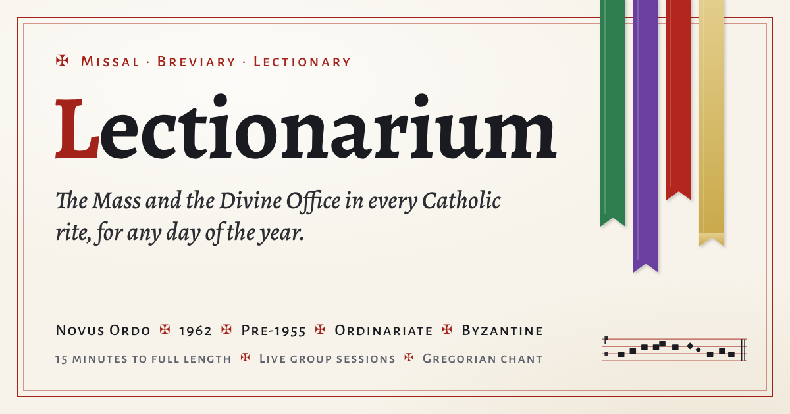

# ✠ Lectionarium

**The Mass and the Divine Office for any day of the year: printed in full where the texts are free to print, guided by citation where they are not.**

👉 **https://jcalepos146.github.io/LECTIONARIUM/**



## What it does

- **Pray today**: answer three questions (Mass or Office, which rite, which hour) and get a step-by-step guide for any day from 30 November 2025 to 30 November 2030.
- **Every rite and use**:
  - Mass: Novus Ordo, Ordinariate (Divine Worship), 1962 Missal, pre-1955, the hybrid proposal and the Byzantine Divine Liturgy.
  - Office: the Liturgy of the Hours, the Ordinariate Daily Office, and the 1962, pre-1955, Monastic and Dominican Breviaries, with Byzantine Office outlines.
- **Any length**: fit a service to anything from 15 minutes up to full length. The guide trims step by step and shows what was cut.
- **Live group sessions**: a host shares a code, and everyone else follows the same day, settings and position. The host can assign parts (celebrant, server, lector, people), see who is ready, and start music for everyone. Sessions run browser to browser, with no account needed.
- **Music**: Gregorian propers and Ordinary in chant notation with playback, plus hymns.
- **Your texts**: wherever a text is still copyrighted, press **Add text** and type or paste it from your own missal or breviary. It's kept in your browser and shown in place from then on, and you can export or import your collection.
- **Full texts where they are free to use**:
  - The traditional Breviary in Latin and English.
  - The psalms and canticles of the Liturgy of the Hours (four-week psalter).
  - The psalms and fixed prayers of the Byzantine hours.
  - The Ordinariate Mass propers.
  - The Novus Ordo Ordinary in Latin, with traditional English.
  - Mattins and Evensong from the 1662 Book of Common Prayer, with the Coverdale psalter.
  - Scripture readings in the Douay-Rheims and King James versions.
- **Tools**: a presenter view for screen-sharing, a chat-script export for Discord or Minecraft (copy and paste), read-aloud, role views, posture cues and a printable booklet.
- **Compare**: every lectionary side by side for the whole year, with feast precedence.

## Text coverage

Every rite is labelled in the app so you know before you open it what it prints.

| Rite | Mass | Office |
|---|---|---|
| 1962, pre-1955, hybrid | **Complete text** | **Complete text** |
| Monastic, Dominican | n/a | **Complete text** |
| Ordinariate | *Guided*: 1662 texts, Canon and propers; Divine Worship wording differs in places | **Complete text** (1662 Mattins, Evensong, Compline) |
| Novus Ordo / Liturgy of the Hours | *Guided*: readings and Latin Ordinary; collects, preface, Eucharistic Prayer from your missal | *Guided*: psalms, canticles, Scripture; hymns, antiphons, prayers from your breviary |
| Byzantine | *Order and readings*: prayers from your service book | *Guided*: psalms and fixed prayers; hymns of the day from your books |

The comparison tabs (Compare the year, Every lectionary, Hybrid, 1955 vs 1962, Divine Office) are reference tables of citations.

## Hosting a session

1. Open a Mass or an hour, then choose **Live session → Host with these settings**.
2. Send people the page link and the code. They enter the code on the front page.
3. Keep your tab open; the session runs from your browser.

Sessions connect browsers directly (WebRTC through the free PeerJS signalling service). Some school or office networks block this; **Live session → Check the connection** tells you if yours does.

## Sources and licences

- **Traditional Breviary and Missal texts**: generated with the [Divinum Officium](https://github.com/DivinumOfficium/divinum-officium) program from its data (MIT licence).
- **Byzantine daily readings**: a port of [orthocal](https://github.com/brianglass/orthocal) by Brian Glass (MIT licence).
- **Book of Common Prayer (1662)**: public domain, except in the United Kingdom, where the Crown holds perpetual rights.
- **Scripture**: Douay-Rheims (public domain) and King James Version (public domain, except Crown rights in the UK).
- **Live sessions**: [PeerJS](https://peerjs.com) (MIT licence).
- **Not reproduced**: texts still in copyright, namely the Liturgy of the Hours, Divine Worship, the Roman Missal translations and Byzantine Daily Worship. They are cited and cued instead.

The full list is on the site's **Sources** tab.

*Lectionarium is a study and practice aid. For celebration, consult the approved liturgical books.*

## Sanctuary mode (development branch)

Choose **Enter Sanctuary mode** or press **S** outside a text field. Browse the
night-time library with mouse, touch, arrow keys and Enter, or a gamepad. Escape /
Backspace or gamepad B returns to the parent; `/` or gamepad Y opens Search. Start
opens text-size, theme, optional sound and exit controls. Sound starts off. Exit
returns to the existing page; Pray now opens the existing guide.

Routes: `#/sanctuary`, `#/t/catholic`, `#/t/catholic/latin`, and `#/search`.
The catalog is fetched only on Sanctuary entry. Sources references are included
in the generated HTML. Recent guides
and Sanctuary preferences stay in localStorage; no account or analytics is used.
Only entries with mapped guides offer Pray now. Byzantine Catholic mappings are
explicitly practice guides using this site's Gregorian Pascha and Slavic reading
order, not a claim to compute every local church calendar.

### Develop and check

```sh
python3 -m http.server 8000
python3 src/assemble.py
# Browser tooling only, preferably inside a virtual environment:
python3 -m pip install -r requirements-dev.txt
npm ci --ignore-scripts --no-audit --no-fund
# Supply Chromium at /usr/bin/chromium, or set PLAYWRIGHT_CHROMIUM.
python3 tools/build_traditions.py
python3 tools/build_traditions.py --check
python3 -m unittest discover -s tests -v
```

Tests start an isolated local server. They exercise actual checked-in data and
local guides, with external CDN/font requests blocked for reproducibility.
The live-session regression uses pinned local PeerJS client/server packages and
two real browser contexts. It runs in CI; managed browsers that explicitly block
direct WebRTC skip that test. Public signalling, NAT traversal and CDN availability
remain outside this local suite. Node packages are development tools only.
Screenshots go to `/tmp/lectionarium-screenshots` (override `SCREENSHOT_DIR`).

### Release status and follow-up

The 137-entry directory is a **seed catalog pending current-source review**.
Every entry carries source URLs and an explicit review status. Some official source sites block automated access. Current OCA and Ecumenical
Patriarchate sources have been reviewed; see `docs/source-review.md` for the
remaining edition and jurisdiction checks. Reachability does not establish that
a claim or copyright assessment is correct.
Run `python3 tools/audit_tradition_sources.py` after applying the source-domain
allowlist, then review claims against the actual pages before release. In
particular, review disputed autocephaly, local calendar variants, Prayer Book
territorial rights and the exact editions of historical hymnals and translations.
Conservative copyright labels mean “not cleared for reproduction here”, not a
legal conclusion that every part is protected.

Each catalog entry has a generated `t/<id>/index.html` with its own title,
description, canonical URL and redirect. Churches and traditions have individual 1200×630 cards; book editions inherit
family artwork. The generator keeps the complete project below the 512-file limit.
Cards use `tools/card.html`, with no church logos or insignia.

New Anglican, Lutheran and Reformed service texts (Part C of the feature request)
follow release of the launcher and reviewed directory. They are not implemented
in this change. The attached *Divine Liturgies Public Domain Companion* identifies
Hapgood (1906) as its historical source, but its own introduction says the
anthology is not complete. Byzantine builders therefore retain their honest
**Order and readings** coverage; no modern copyrighted translation has been
imported. Monastic chant is extended through 30 November 2030. The pack preserves every
existing text and chant cell for all 1,827 supported days. All seven chant-mode
hours are present; the source has no notation for 75 Triduum little-hour records,
and Matins remains text-only.

To reproduce the extension from the original packed data:

```sh
git clone https://github.com/DivinumOfficium/divinum-officium.git /tmp/lectionarium-do
git -C /tmp/lectionarium-do checkout df1ebc65f16f3b9026c4cae43fa8c0c1ba7cfded
export LECTIONARIUM_DO=/tmp/lectionarium-do
export LECTIONARIUM_OFFICE_WORK=/tmp/lectionarium-office
export LECTIONARIUM_OFFICE_WORKERS=4
python3 tools/office_gen.py unpack mon
python3 tools/office_gen.py gen mon 2027-02-14 2030-11-30 chant
python3 tools/office_gen.py pack mon 2000
python3 tools/check_office.py "$LECTIONARIUM_OFFICE_WORK/breviary/mon" --baseline breviary/mon --chant-through 2030-11-30
# After validation, replace breviary/mon with the generated packed directory.
```

`unpack` recovers the complete published cache before extending it. On a checkout
already containing the extension, generation has nothing to add. The source
revision, original baseline, validation and full MIT notice are recorded in
`data/monastic-build.json`. The generator fixes the Perl shim path, bounds worker
count, rejects empty output and stages packed output before replacing it.

To keep the site within 512 files, the existing br55 and br62 packs have been
consolidated into 4 MB shards with `office_gen.py rechunk br55 4000` and
`office_gen.py rechunk br62 4000` under a separate `LECTIONARIUM_OFFICE_WORK`.
This operation preserves every line, row and day ID. Both packs passed full
rendered-cell and title comparison against their original directories before
replacement. It changes fetch sizes, not the liturgical content.
